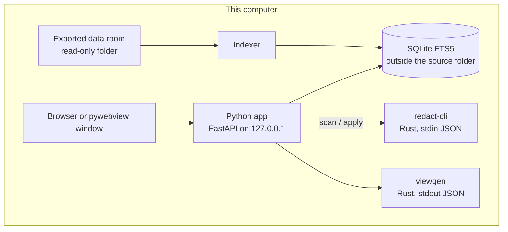

# Architecture

Lawbat is a local program. A lawyer points it at a folder that was already exported from a data room. The program reads that folder, indexes it, and serves pages on `127.0.0.1`. Matter bytes do not go to a vendor or a model.

## Pages

**Home (`/`).** Renders a `firmos.view/0` worklist. `viewgen` prints the JSON. If the binary is missing, a bundled sample is shown and marked as a preview. Every matter string is escaped before it is inserted into the page.

**Data room (`/app`).** Search and tools over the open matter. The schedule and batch rename live here. Rename is preview, then apply, then undo, and it will not write into the source root.

**Redaction (`/redaction`).** The reviewer is several scripts (`app/ui/redaction.*.js`) assembled into one page at startup, in a fixed order: state, stepper, gates, scan, review, PDF, OCR, export, batch, provenance, and release. Stages are Document, Detect, Review, Export, and Report. Sensitive-passage acknowledgement sits inside Review. Export stays locked until the scan is fresh, every careful finding is decided, and every flagged passage is ticked. The page talks to `redact-cli` over stdin and stdout. PDF apply splices matched bytes out of the text-showing operators.

**Document workspace (`/workspace`).** A second surface for the same engine. A redaction is prepared into a private staging area. The first response is a preparation manifest, not a finished export. Releasing the file is a separate token-guarded step and requires an inspection attestation. Reported removal failures cannot be overridden.

**Re-identification (`/reid-risk`).** `app/reidrisk.py` scores a passage against bundled population tables. k is an estimate under an independence assumption. Medical conditions are tiered and are not multiplied into k. There is no "safe" state.

## Data flow

1. Demo mode (`python -m app.serve --demo`) indexes `demo/sample-room/` and opens that database. A normal run asks for a folder.
2. Search goes to `/api/search` and SQLite FTS5 returns filename, locator, and a snippet.
3. `/api/tools/manifest` builds the schedule. CSV export writes outside the source folder.
4. Redaction posts text or a file to `/api/redaction/*` with the per-session `X-DRR-Token`. Apply writes a new artifact. The upload is not overwritten in place.
5. `/api/reidrisk/score` runs in process. The text is not stored.

The pages inline their CSS and script. They do not load a font, a CDN, or a remote script. The favicon is a data URI. State-changing routes require the token minted into the page, so another site in the same browser cannot start an index or a rename.

## What is deliberately absent

No account server, no telemetry, and no model runtime. Optional OCR uses a local Tesseract binary when one is installed. The Windows MSI build (`build/`, `.github/workflows/package-windows.yml`) is not required to run the demo from source.
