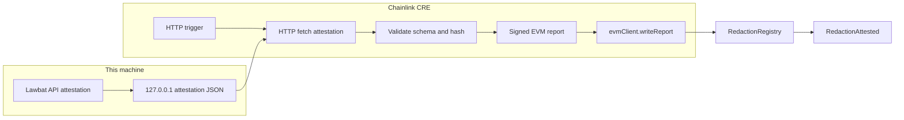

<p align="center">
  
</p>
<p align="center">
  
</p>

# Lawbat

**Local-first redaction and re-identification risk checks for legal documents.**

## For judges (60 seconds)

| | |
|---|---|
| **What** | A local review desk for an exported legal data room: search, schedule, lawyer-in-the-loop redaction, re-identification concern estimates. |
| **Problem** | Closing / regulatory folders still need identifiers stripped before a draft goes out. Hosted tools assume IT and an upload of privileged material. |
| **Privacy** | No model call. No network from the app. Originals stay read-only. |
| **BLI** | [Hackathon page](https://bli.tools/hackathon/) · [ARCHITECTURE.md](ARCHITECTURE.md) · [docs/BLI_SUBMISSION.md](docs/BLI_SUBMISSION.md) · [2.5-min demo](docs/demo/lawbat-demo.mp4) |
| **Chainlink** | Optional CRE audit trail under [`cre/`](cre/): attestation hashes → CRE workflow → `RedactionRegistry` / `RedactionAttested`. **Simulation only** (CRE deploy access not enabled). Proof: [cre/SIMULATION.md](cre/SIMULATION.md). How to reproduce: [cre/README.md](cre/README.md). |

**Quickstart that works without Rust** (search + schedule; redaction shows an honest offline state until `cargo build`):

```bash
git clone https://github.com/wenbinio/lawbat.git && cd lawbat
python3 -m venv .venv && source .venv/bin/activate   # Windows: .venv\Scripts\activate
pip install -r requirements.txt
./run.sh --demo                                      # Windows: run.bat --demo
```

Then open <http://127.0.0.1:8077/>. Prefer the [demo video](docs/demo/lawbat-demo.mp4) if you only have a minute. Full redaction needs the Rust build in [Run the demo](#run-the-demo).

## Demo video

[Watch the 2.5-minute demo](docs/demo/lawbat-demo.mp4).

Search an exported data room, build a schedule of documents, and redact identifiers with a lawyer in the loop. Originals stay read-only. The app does not call a model and does not use the network.

This tree is the public source for the [BLI Legal Tech Hackathon 2](https://bli.tools/hackathon/) submission and the Chainlink **Best workflow with CRE** bounty application on DoraHacks. Start with the demo, then read [ARCHITECTURE.md](ARCHITECTURE.md) and [docs/BLI_SUBMISSION.md](docs/BLI_SUBMISSION.md).

## The problem

A closing or a regulatory response often arrives as a folder of PDFs, emails, and office files. Someone still has to find the right document, list the room, and remove identifiers before a draft goes out. Hosted review tools assume an IT team and an upload of privileged material. Desktop search and find-and-replace miss messy files and leave identifiers in the copy that is actually sent.

## What it does

- **Search** at `/app`. Full-text over PDF, Word, Excel, PowerPoint, text, and email. Hits point at a page, a slide, or a sheet.
- **Document schedule.** A read-only index of the open room, folder-grouped, with a CSV export. Scanned pages are marked as needing OCR.
- **Redaction review** at `/redaction`. A deterministic Rust engine proposes emails, phone numbers, ID-shaped strings, payment numbers, addresses, and party names you type in. The reviewer is split into stages: Document, Detect, Review (findings and sensitive passages together), Export, and a Report of what was saved. You can also review a folder of files. On a text PDF the engine removes the underlying text.
- **Document workspace** at `/workspace`. Prepare a redaction, inspect it, and only then release the file. Release is a separate step and asks for an explicit inspection attestation. A removal failure cannot be clicked through.
- **Re-identification risk** at `/reid-risk`. Estimates how unique a passage still looks. The figure is an optimistic lower bound. It can raise concern. It never says a document is safe to send.
- **Home** at `/`. A local worklist. If the Rust `viewgen` binary is present it is generated on this machine. If not, the page says it is a preview sample.
- **Chainlink CRE audit trail** (optional, separate from the app). After a redaction, Lawbat can export hashes and counts. A CRE workflow can record those on a testnet. The document stays on the machine. See below.

Redaction is reasonable-efforts removal of matched identifiers. It is not a clearance to disclose the document.

## Tech stack

| Piece | Role |
|---|---|
| Python 3.11 or 3.12, FastAPI, uvicorn | Localhost app (`app/`, `desktop/`) |
| SQLite FTS5 | Per-matter index, stored outside the source folder |
| PyMuPDF, python-docx, openpyxl, python-pptx, extract-msg | Format extractors |
| Rust (`core/`) | Redaction engine (`redact-cli`), home view-model (`viewgen`) |
| pywebview + WiX | Windows desktop shell and MSI (Lawbat, and a redaction-only Redactor installer) |

License: **AGPL-3.0**. See [LICENSE](LICENSE) and [to-read/THIRD_PARTY_LICENSES.md](to-read/THIRD_PARTY_LICENSES.md). Windows install notes: [docs/INSTALL.md](docs/INSTALL.md).

## Run the demo

From a fresh clone. Python 3.11 or 3.12 preferred (3.13 works for the demo). Rust stable is needed for live redaction and the Home worklist generator.

```bash
git clone https://github.com/wenbinio/lawbat.git
cd lawbat

python3 -m venv .venv && source .venv/bin/activate   # Windows: .venv\Scripts\activate
pip install -r requirements.txt

# Optional but recommended for a full redaction demo:
cd core && cargo build -p redact-cli -p viewgen --release && cd ..

./run.sh --demo
```

`./run.sh --demo` indexes the fictional folder `demo/sample-room/` (a made-up Harbour Lane matter, not a client file), stores that index under `.demo-data/` in the clone, and opens <http://127.0.0.1:8077/>.

| Page | URL | What to do |
|---|---|---|
| Home | <http://127.0.0.1:8077/> | Local worklist. A preview banner means `viewgen` was not found. |
| Data room | <http://127.0.0.1:8077/app> | Search `Harbour Lane`. Tools, then Document index, then Build index. |
| Redaction | <http://127.0.0.1:8077/redaction> | **Try it with a sample document**, then scan and review. |
| Workspace | <http://127.0.0.1:8077/workspace> | Inspect a prepared redaction before it is released. |
| Re-ID risk | <http://127.0.0.1:8077/reid-risk> | Paste `demo/sample-room/02-corporate/directors.md` and estimate k. |

On Windows, `run.bat --demo` does the same. Without Rust, search and the schedule still work. Redaction then shows an honest offline state, and Home shows the bundled sample.

Check setup any time with `PYTHONPATH=. python3 -m app.doctor`.

## Tests

```bash
python3 -m pip install httpx
PYTHONPATH=. python3 tests/test_demo.py
PYTHONPATH=. python3 tests/test_smoke.py
PYTHONPATH=. python3 tests/test_e2e.py
python3 -m ruff check app desktop tests
```

`ruff.toml` keeps the lint rule set this tree is written against.

## Architecture (app)

Lawbat indexes a local folder, serves pages on `127.0.0.1`, and keeps matter bytes on the machine. See [ARCHITECTURE.md](ARCHITECTURE.md) for the full diagram (indexer → SQLite FTS5 → redact-cli / viewgen). The optional CRE path below is separate: the app still does not open the network; only an attestation HTTP server you start on loopback is fetched by the CRE simulator.

## Chainlink CRE audit trail

A redaction report on disk is a local workflow record. It is not, by itself, tamper-evident. The optional workflow under [`cre/`](cre/) is the tamper-evident step: it takes a **redaction attestation** (hashes and counts only) and asks Chainlink CRE to write those hashes to [`RedactionRegistry`](cre/contracts/src/RedactionRegistry.sol) on Ethereum Sepolia. The chain shows that this tool version assessed a redacted document at a given time, and what the re-identification risk level was. It does not show the document, the names, or a decision that the document is cleared to send.

**Status for judges:** the workflow was simulated successfully with the CRE CLI (`cre workflow simulate`). **This is simulation only** — CRE deploy access on the account is not enabled, and nothing was broadcast to a public network. Full proof: [cre/SIMULATION.md](cre/SIMULATION.md). Reproduce from scratch: [cre/README.md](cre/README.md).

Lawbat itself still does not call a model and does not open the network. The attestation server binds to `127.0.0.1`. The CRE workflow refuses an attestation URL that is not on this machine. The only bytes intended for the chain are the redacted-output SHA-256, the report hash, a risk level from 0 to 3, and a timestamp.



`POST /api/attestation` (session token required) builds the JSON from a redaction report. `GET /api/attestation/latest` returns the last one. The same builder is available without the app:

```bash
PYTHONPATH=. python3 -m app.attestation sample --out cre/fixtures/sample-attestation.json
PYTHONPATH=. python3 -m app.attestation serve --file cre/fixtures/sample-attestation.json
```

The workflow entry is `cre/workflow/main.ts`. On an HTTP trigger it GETs the attestation, checks the report hash, ABI-encodes `(bytes32 docHash, bytes32 reportHash, uint8 riskLevel, uint64 ts)`, and submits that through `runtime.report` and `evmClient.writeReport`. The consumer contract is `cre/contracts/src/RedactionRegistry.sol`. `getAttestation(docHash)` reads a record back.

### Simulation

The Lawbat CRE workflow was simulated successfully with the Chainlink CRE CLI (`cre workflow simulate`, CLI v1.39.0). See [cre/SIMULATION.md](cre/SIMULATION.md) and [cre/simulation.log](cre/simulation.log). The run fetched a loopback attestation, validated it, signed an EVM report, and completed `writeReport` as a dry-run (no public-network broadcast). **Deploy access is not enabled.** This repository does not ship an account, an API key, or funds.

One-command repro (after the one-time setup in [cre/README.md](cre/README.md) — CLI install, `cre login`, attestation server, Anvil):

```bash
cd cre && cre workflow simulate workflow --target local-simulation --non-interactive \
  --trigger-index 0 --http-payload '{"attestationUrl":"http://127.0.0.1:8765/attestation"}'
```

`cre/simulate-local.sh` remains the offline dry-run (no CRE login): it fetches the attestation over HTTP and writes it on a local Anvil node (chain id 11155111) using Anvil's public development account as a stand-in for the KeystoneForwarder. That account is not a secret and is not funded.

```bash
cd cre/contracts && forge install foundry-rs/forge-std && forge test
cd ../.. && ./cre/simulate-local.sh
```

Risk levels are concern signals only: `not_assessed` (0), `noted` (1), `high` (2), `unique` (3). A higher k does not mean the document is cleared.

Excerpt from the CRE CLI simulation recorded in [cre/SIMULATION.md](cre/SIMULATION.md):

```
✓ Workflow compiled
2026-10-31T23:50:49Z [SIMULATION] Running trigger trigger=http-trigger@1.0.0-alpha
2026-10-31T23:50:49Z [USER LOG] Validated attestation doc=c00fa5552c2163e586279bec72ed7436b095b4d07c46a0485dce535359b7cf61 risk=high categories=3
2026-10-31T23:50:49Z [USER LOG] Signed the EVM report. Submitting it to RedactionRegistry.
2026-10-31T23:50:49Z [USER LOG] RedactionAttested dry-run succeeded tx=0x0000000000000000000000000000000000000000000000000000000000000000
✓ Workflow Simulation Result: ... risk_level: 2 ...
Simulation complete!
```

## Layout

- `app/` — indexer, search, redaction reviewer, document workspace, re-identification estimator, attestation export
- `cre/` — Chainlink CRE workflow, `RedactionRegistry`, simulation proof ([cre/README.md](cre/README.md))
- `desktop/` — Windows launcher
- `core/` — Rust workspace. Build notes: [to-read/core.README.md](to-read/core.README.md)
- `demo/sample-room/` — fictional data room used by `--demo`
- `assets/logo/` — logo, app icon, and the DoraHacks cover
- `tests/*.pdf` and `demo/*.pdf` — public fund prospectuses used as redaction fixtures, not client files
