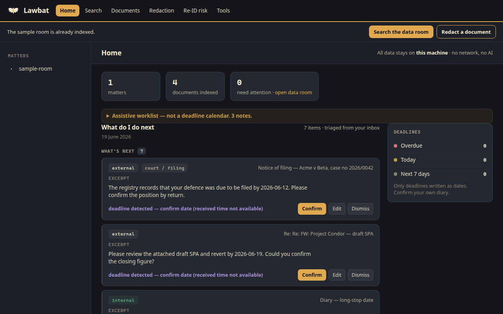
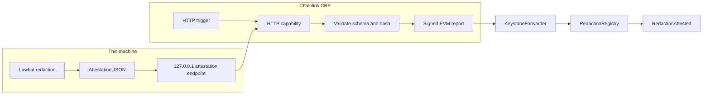

<p align="center">
  
</p>
<p align="center">
  
</p>

# Lawbat

**Local-first redaction and re-identification risk checks for legal documents.**

## Demo video

[Watch the 2.5-minute demo](docs/demo/lawbat-demo.mp4).

Search an exported data room, build a schedule of documents, and redact identifiers with a lawyer in the loop. Originals stay read-only. The app does not call a model and does not use the network.

This tree is the public source for the [BLI Legal Tech Hackathon 2](https://bli.tools/hackathon/) submission. Start with the demo, then read [ARCHITECTURE.md](ARCHITECTURE.md) and [docs/BLI_SUBMISSION.md](docs/BLI_SUBMISSION.md).

## The problem

A closing or a regulatory response often arrives as a folder of PDFs, emails, and office files. Someone still has to find the right document, list the room, and remove identifiers before a draft goes out. Hosted review tools assume an IT team and an upload of privileged material. Desktop search and find-and-replace miss messy files and leave identifiers in the copy that is actually sent.

## What it does

- **Search** at `/app`. Full-text over PDF, Word, Excel, PowerPoint, text, and email. Hits point at a page, a slide, or a sheet.
- **Document schedule.** A read-only index of the open room, folder-grouped, with a CSV export. Scanned pages are marked as needing OCR.
- **Redaction review** at `/redaction`. A deterministic Rust engine proposes emails, phone numbers, ID-shaped strings, payment numbers, addresses, and party names you type in. The reviewer is split into stages: Document, Detect, Review (findings and sensitive passages together), Export, and a Report of what was saved. You can also review a folder of files. On a text PDF the engine removes the underlying text.
- **Document workspace** at `/workspace`. Prepare a redaction, inspect it, and only then release the file. Release is a separate step and asks for an explicit inspection attestation. A removal failure cannot be clicked through.
- **Re-identification risk** at `/reid-risk`. Estimates how unique a passage still looks. The figure is an optimistic lower bound. It can raise concern. It never says a document is safe to send.
- **Home** at `/`. A local worklist. If the Rust `viewgen` binary is present it is generated on this machine. If not, the page says it is a preview sample.
- **Chainlink CRE audit trail** (optional, separate from the app). After a redaction, Lawbat can export hashes and counts. A CRE workflow can record those on a testnet. The document stays on the machine. See below.

Redaction is reasonable-efforts removal of matched identifiers. It is not a clearance to disclose the document.

## Tech stack

| Piece | Role |
|---|---|
| Python 3.11 or 3.12, FastAPI, uvicorn | Localhost app (`app/`, `desktop/`) |
| SQLite FTS5 | Per-matter index, stored outside the source folder |
| PyMuPDF, python-docx, openpyxl, python-pptx, extract-msg | Format extractors |
| Rust (`core/`) | Redaction engine (`redact-cli`), home view-model (`viewgen`) |
| pywebview + WiX | Windows desktop shell and MSI (Lawbat, and a redaction-only Redactor installer) |

License: **AGPL-3.0**. See [LICENSE](LICENSE) and [to-read/THIRD_PARTY_LICENSES.md](to-read/THIRD_PARTY_LICENSES.md). Windows install notes: [docs/INSTALL.md](docs/INSTALL.md).

## Run the demo

From a fresh clone, with Python 3.12 and Rust stable:

```bash
git clone https://github.com/wenbinio/lawbat.git
cd lawbat

python3 -m pip install fastapi "uvicorn[standard]" pymupdf python-docx openpyxl python-pptx pillow

cd core
cargo build -p redact-cli -p viewgen --release
cd ..

./run.sh --demo
```

`./run.sh --demo` indexes the fictional folder `demo/sample-room/` (a made-up Harbour Lane matter, not a client file), stores that index under `.demo-data/` in the clone, and opens <http://127.0.0.1:8077/>.

| Page | URL | What to do |
|---|---|---|
| Home | <http://127.0.0.1:8077/> | Local worklist. A preview banner means `viewgen` was not found. |
| Data room | <http://127.0.0.1:8077/app> | Search `Harbour Lane`. Tools, then Document index, then Build index. |
| Redaction | <http://127.0.0.1:8077/redaction> | **Try it with a sample document**, then scan and review. |
| Workspace | <http://127.0.0.1:8077/workspace> | Inspect a prepared redaction before it is released. |
| Re-ID risk | <http://127.0.0.1:8077/reid-risk> | Paste `demo/sample-room/02-corporate/directors.md` and estimate k. |

On Windows, `run.bat --demo` does the same. Without Rust, search and the schedule still work. Redaction then shows an honest offline state, and Home shows the bundled sample.

Check setup any time with `PYTHONPATH=. python3 -m app.doctor`.

## Tests

```bash
python3 -m pip install httpx
PYTHONPATH=. python3 tests/test_demo.py
PYTHONPATH=. python3 tests/test_smoke.py
PYTHONPATH=. python3 tests/test_e2e.py
python3 -m ruff check app desktop tests
```

`ruff.toml` keeps the lint rule set this tree is written against.

## Chainlink CRE audit trail

A redaction report on disk is a local workflow record. It is not, by itself, tamper-evident. The optional workflow under `cre/` is the tamper-evident step: it takes a **redaction attestation** (hashes and counts only) and asks Chainlink CRE to write those hashes to `RedactionRegistry` on Ethereum Sepolia. The chain shows that this tool version assessed a redacted document at a given time, and what the re-identification risk level was. It does not show the document, the names, or a decision that the document is cleared to send.

Lawbat itself still does not call a model and does not open the network. The attestation server binds to `127.0.0.1`. The CRE workflow refuses an attestation URL that is not on this machine. The only bytes intended for the chain are the redacted-output SHA-256, the report hash, a risk level from 0 to 3, and a timestamp.



`POST /api/attestation` (session token required) builds the JSON from a redaction report. `GET /api/attestation/latest` returns the last one. The same builder is available without the app:

```bash
PYTHONPATH=. python3 -m app.attestation sample --out cre/fixtures/sample-attestation.json
PYTHONPATH=. python3 -m app.attestation serve --file cre/fixtures/sample-attestation.json
```

The workflow entry is `cre/workflow/main.ts`. On an HTTP trigger it GETs the attestation, checks the report hash, ABI-encodes `(bytes32 docHash, bytes32 reportHash, uint8 riskLevel, uint64 ts)`, and submits that through `runtime.report` and `evmClient.writeReport`. The consumer contract is `cre/contracts/src/RedactionRegistry.sol`. `getAttestation(docHash)` reads a record back.

### Simulation

`cre workflow simulate` compiles the workflow to WASM and runs it. Chainlink requires a CRE login for that command. This repository does not ship an account, a key, or a request to create one.

From `cre/` after `bun install` in `cre/workflow`:

```bash
cre workflow simulate workflow --target local-simulation --non-interactive \
  --trigger-index 0 --http-payload '{"attestationUrl":"http://127.0.0.1:8765/attestation"}'
```

What ran here, because no CRE account was available, is recorded in [cre/SIMULATION.md](cre/SIMULATION.md). The command above was executed and stopped at authentication. `cre workflow build` compiles the workflow without a login. `cre/simulate-local.sh` is the offline dry-run: it fetches the attestation over HTTP and writes it on a local Anvil node (chain id 11155111) using Anvil's public development account as a stand-in for the KeystoneForwarder. That account is not a secret and is not funded. Nothing is broadcast to Sepolia.

```bash
cd cre/contracts && forge install foundry-rs/forge-std && forge test
cd ../.. && ./cre/simulate-local.sh
```

Risk levels are concern signals only: `not_assessed` (0), `noted` (1), `high` (2), `unique` (3). A higher k does not mean the document is cleared.

Excerpt from the run recorded in [cre/SIMULATION.md](cre/SIMULATION.md). The CRE CLI compile succeeded. The simulate command stopped because this environment is not logged in:

```
✓ Workflow compiled successfully
  Binary hash: 594a17d7d2e2cbf24b1d41d1d84581dc59f7eeba063cef755b2784718ef79955
✗ Authentication required: not logged in and no CRE_API_KEY set
exit code: 1
```

The local dry-run then fetched the attestation and wrote it on Anvil. The read-back matched:

```
read-back matches docHash
decoded:
  docHash: 0xc00fa5552c2163e586279bec72ed7436b095b4d07c46a0485dce535359b7cf61
  reportHash: 0xa2ad3d397b3a6f3117726ab028fd8a2a055c1319efe5a4e0196446d0edbb462e
  riskLevel: 2
  ts: 1793447787
LOCAL_DRY_RUN_OK
```

## Layout

- `app/` — indexer, search, redaction reviewer, document workspace, re-identification estimator, attestation export
- `cre/` — Chainlink CRE workflow, `RedactionRegistry`, and the local simulation log
- `desktop/` — Windows launcher
- `core/` — Rust workspace. Build notes: [to-read/core.README.md](to-read/core.README.md)
- `demo/sample-room/` — fictional data room used by `--demo`
- `assets/logo/` — logo, app icon, and the DoraHacks cover
- `tests/*.pdf` and `demo/*.pdf` — public fund prospectuses used as redaction fixtures, not client files
